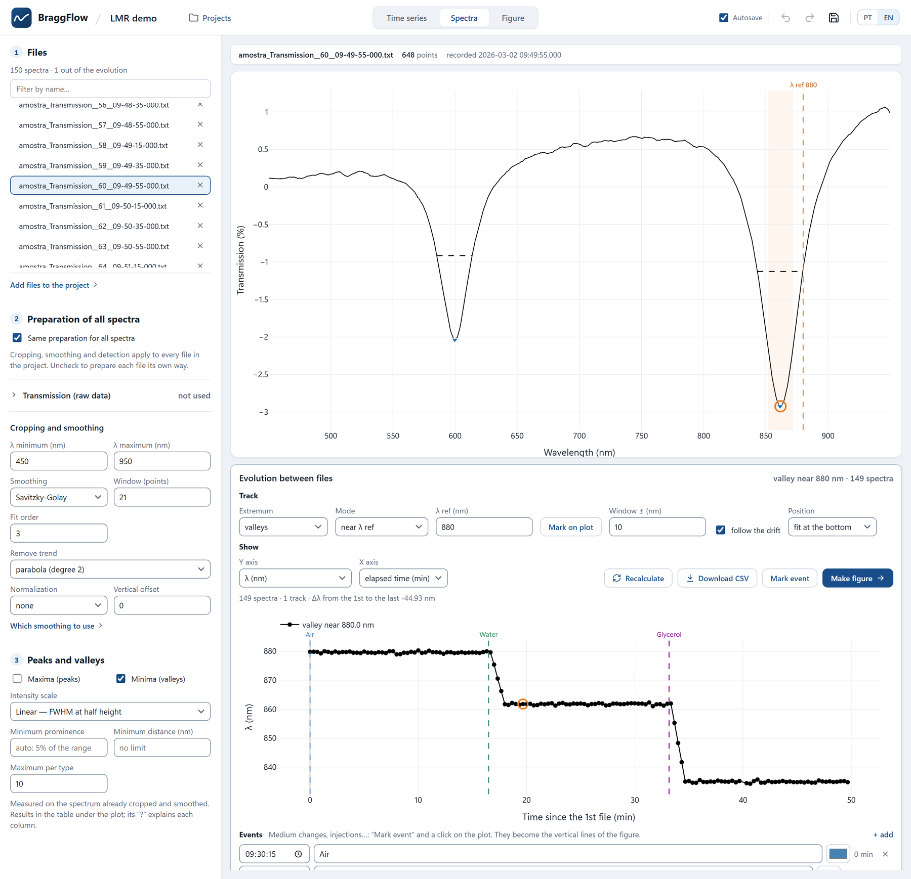
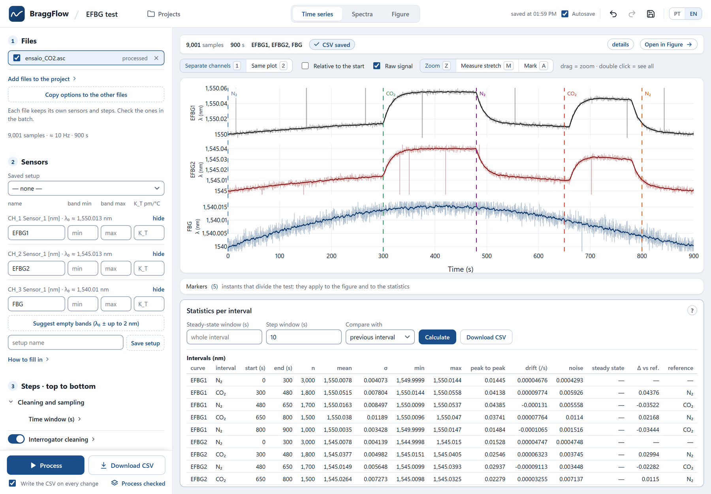
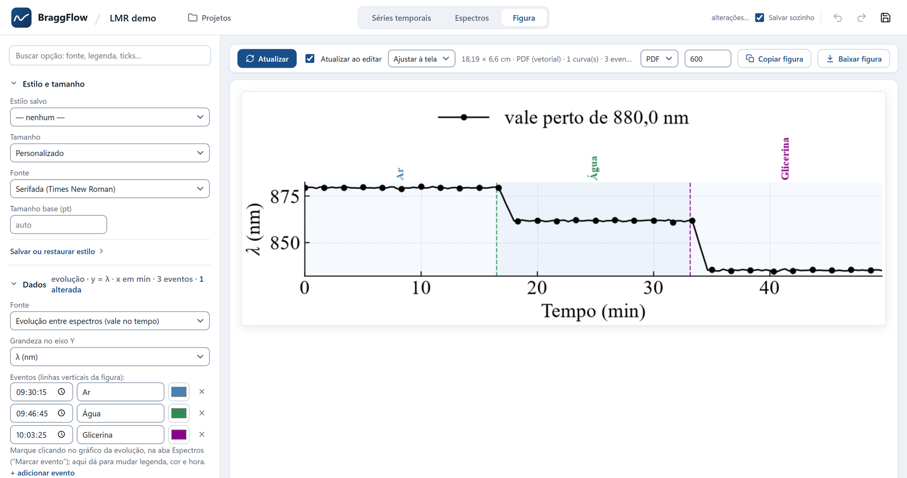

<p align="center">
  <picture>
    <source media="(prefers-color-scheme: dark)" srcset="docs/images/logo-dark.svg">
    
  </picture>
</p>

<p align="center">
  <b>From raw optical-sensor exports to traceable numbers and journal-ready figures.</b>
</p>

<p align="center">
  <a href="https://github.com/PedroSartorello/BraggFlow/actions/workflows/tests.yml"></a>
  
  <a href="LICENSE"></a>
</p>

BraggFlow is an open-source workbench for optical fibre sensor research. It
takes FBG interrogator data and optical spectra (OSA, UV-VIS-NIR, OceanView
LMR exports, catman `.BIN`) from the files the equipment wrote to the numbers and figures of
a paper. It runs in the browser, on your own computer, in English or
Brazilian Portuguese.



## Why BraggFlow

- **One tool from raw file to figure.** It replaces the mix of spreadsheets,
  one-off scripts and the instrument's own software.
- **Traceable.** Every processed CSV carries its units and a JSON record of
  how it was made: the source file and its hash, every step and its
  parameters.
- **It speaks the lab's language.** λ, Δλ, FWHM, Q, temperature compensation,
  and valleys tracked across hundreds of spectra.
- **Built for real tests.** Long series and whole folders of spectra are
  processed in batch. An unreadable file is reported and skipped.
- **Your data stays with you.** Everything runs locally, in one data folder.

## Screenshots

| Time series: markers and statistics per interval | Figure: journal-sized, ready to export |
| --- | --- |
|  |  |

<sub>Every screenshot uses synthetic data generated by the scripts in this
repository.</sub>

## Quick start

You need [Python](https://www.python.org/downloads/) 3.10 or newer and
[Git](https://git-scm.com/downloads). Run one line at a time. The commands
create a virtual environment in `.venv` and call its Python directly, so
there is nothing to activate.

**Windows** (PowerShell or Command Prompt):

```bat
git clone https://github.com/PedroSartorello/BraggFlow.git
cd BraggFlow
py -m venv .venv
.venv\Scripts\python -m pip install -e .
.venv\Scripts\python examples\make_synthetic_data.py
.venv\Scripts\python -m braggflow.webapp.app
```

**Linux and macOS:**

```bash
git clone https://github.com/PedroSartorello/BraggFlow.git
cd BraggFlow
python3 -m venv .venv
.venv/bin/python -m pip install -e .
.venv/bin/python examples/make_synthetic_data.py
.venv/bin/python -m braggflow.webapp.app
```

The last line opens BraggFlow in the browser, on http://127.0.0.1:5000 or
the next free port. Ctrl+C in the terminal stops it. Next time, go into the
`BraggFlow` folder and run only that line. Without Git, download the ZIP from
the green **Code** button on GitHub, unzip it, go into the `BraggFlow-main`
folder and start from the third line.

If a step fails, [Installation problems](docs/webapp.md#installation-problems)
lists the usual messages and what to do.

## The library

The web app runs on `braggflow`, a Python package you can also use on its
own. It provides:

- readers for interrogator and spectrum exports;
- a chainable processing pipeline;
- interval statistics;
- publication figures.

```python
from braggflow import OpticalPipeline
from braggflow.processing import remove_outliers, apply_savgol_filter, to_delta_lambda

(OpticalPipeline("examples/data/synthetic_interrogator.asc")
    .load_data()
    .preprocess(remove_outliers, method="rolling", threshold=3.5, strategy="linear")
    .apply_filter(apply_savgol_filter, window_length=11, polyorder=2)
    .apply_filter(to_delta_lambda, baseline_samples=20)
    .save_processed_data("data/processed/example.csv"))   # + example.json
```

Or from the terminal: `braggflow process <file>`.

More documentation:

- the library: [`docs/python-library.md`](docs/python-library.md);
- the web app: [`docs/webapp.md`](docs/webapp.md);
- file formats: [`docs/data-formats.md`](docs/data-formats.md).

## Contributing

Issues and pull requests are welcome. [`CONTRIBUTING.md`](CONTRIBUTING.md)
covers the setup, the tests (`pytest`) and how to add a processing step.
Changes are listed in [`CHANGELOG.md`](CHANGELOG.md).

## Security and data

- **Local only.** The web app listens only on `127.0.0.1` and has no login,
  so don't expose it to a network. Your files never leave your computer; the
  page only loads Plotly from a CDN.
- **Data folder.** The data folder is ignored by git. Examples and tests use
  synthetic data only, so never commit real measurements.
- **Vulnerabilities.** Please report them privately: see
  [`SECURITY.md`](SECURITY.md).

## Open source

BraggFlow is released under the [MIT license](LICENSE). It is developed at
UTFPR (CPGEI / NUEM). If it helps your research, please cite it:
[`CITATION.cff`](CITATION.cff) feeds GitHub's "Cite this repository" button.
